

<strong>LUNARA</strong> SHOP

<h1>A Refined Digital Fashion Experience</h1>

Lunara is a Laravel-powered fashion commerce application built around considered product discovery, warm editorial design, and an operational back office.

  <a href="#showcase">Showcase</a> ·
  <a href="#capabilities">Capabilities</a> ·
  <a href="#architecture">Architecture</a> ·
  <a href="#setup">Setup</a> ·
  <a href="#roadmap">Roadmap</a>

  
  
  
  
  
  

  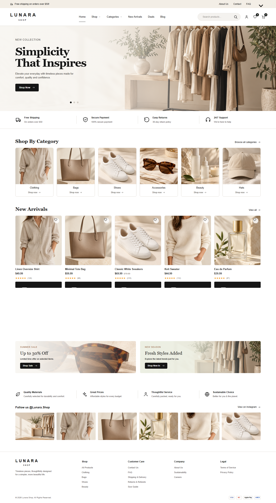

> **Project status** — The repository contains a working local storefront, authenticated account area, commerce flows, and role-protected admin modules. A public live demo is not published in this repository.

## Contents

- [Overview](#overview)
- [Showcase](#showcase)
- [Capabilities](#capabilities)
- [Technology](#technology)
- [Architecture](#architecture)
- [Project structure](#project-structure)
- [Setup](#setup)
- [Quality and security](#quality-and-security)
- [Roadmap](#roadmap)
- [Assets and provenance](#assets-and-provenance)

## Overview

Lunara presents a modern fashion storefront through a restrained black, ivory, beige, and warm-neutral visual language. The active application is served by Laravel Blade views, with Vite-managed assets and Alpine.js for lightweight browser interactions.

The experience covers the main journey from discovery to order creation:

1. Browse a curated catalogue by category, search, sort order, or collection route.
2. Inspect a product, its variant, availability, imagery, and related pieces.
3. Add items to a guest or authenticated cart.
4. Sign in and complete shipping details, optional coupon redemption, and order creation.
5. Manage customer information, orders, catalogue content, inventory, and store operations through protected areas.

The original static prototype files remain in the root for reference. The active Laravel path is the source of truth for the storefront documented here.

## Showcase

The images below are local Playwright captures committed under docs/screenshots. They cover the five reference routes exercised by tests/e2e/lunara.spec.js at desktop and mobile widths.

<table>
  <thead>
    <tr>
      <th>Experience</th>
      <th>Desktop · 1440px</th>
      <th>Mobile · 390px</th>
    </tr>
  </thead>
  <tbody>
    <tr>
      <td><strong>Homepage</strong> Editorial hero, categories, arrivals, promotions, benefits</td>
      <td></td>
      <td>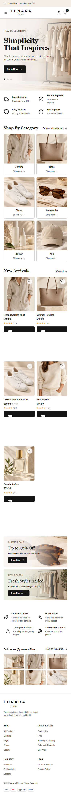</td>
    </tr>
    <tr>
      <td><strong>Product collection</strong> Catalogue, category navigation, sorting, pagination</td>
      <td>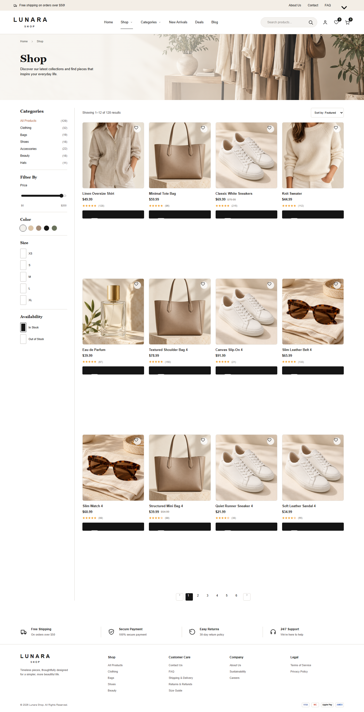</td>
      <td>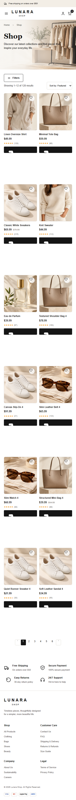</td>
    </tr>
    <tr>
      <td><strong>Category</strong> Category-scoped catalogue and product cards</td>
      <td>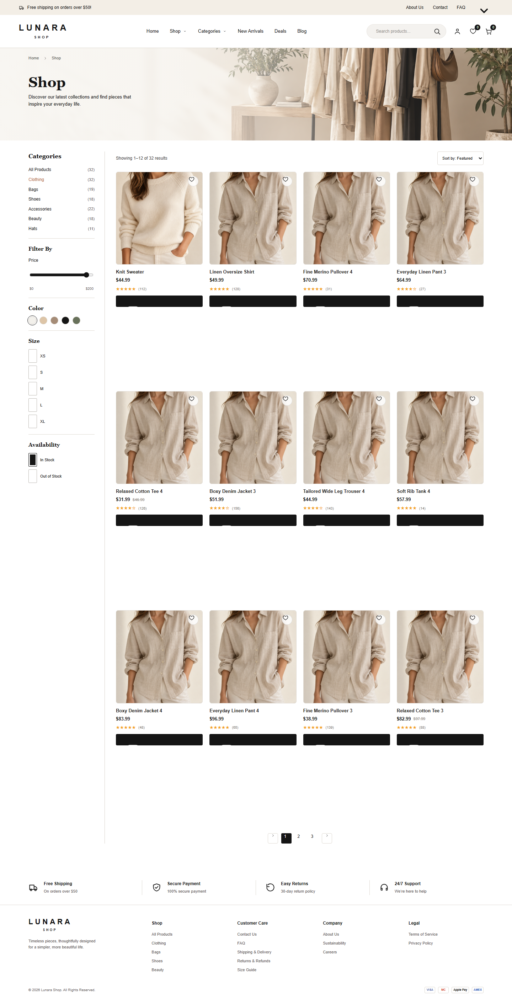</td>
      <td>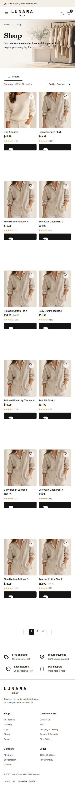</td>
    </tr>
    <tr>
      <td><strong>Product detail</strong> Product imagery, variant choice, stock-aware cart action</td>
      <td>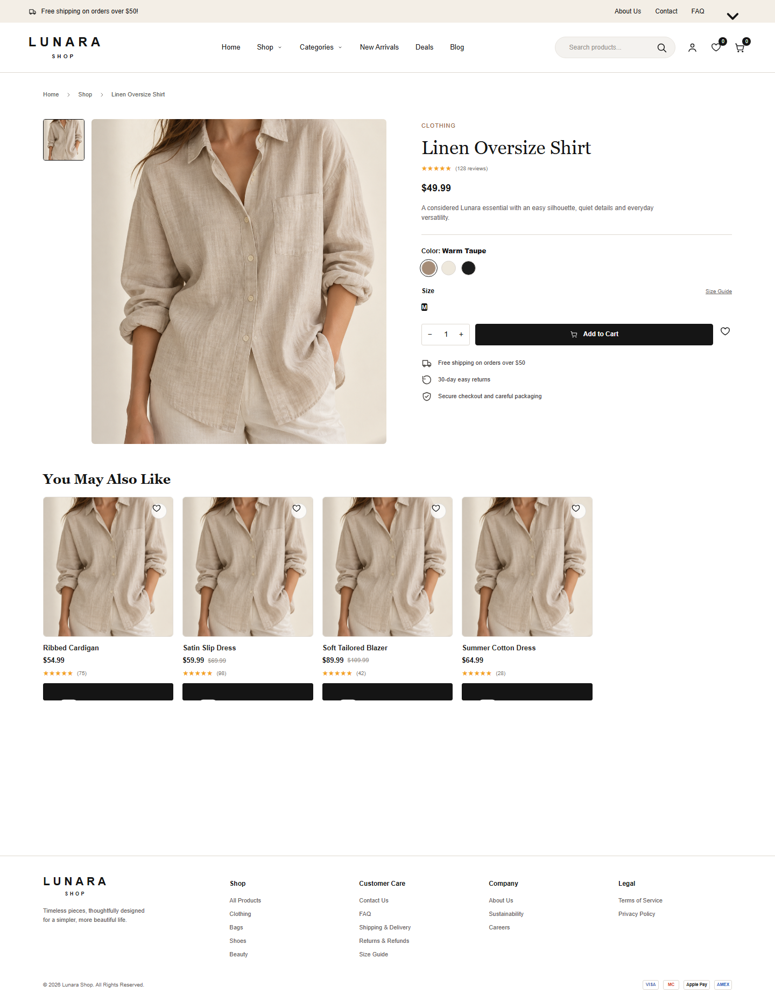</td>
      <td>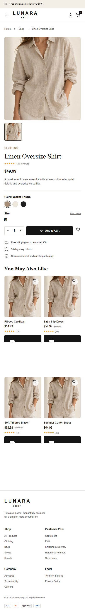</td>
    </tr>
    <tr>
      <td><strong>About</strong> Brand story and responsive editorial layout</td>
      <td>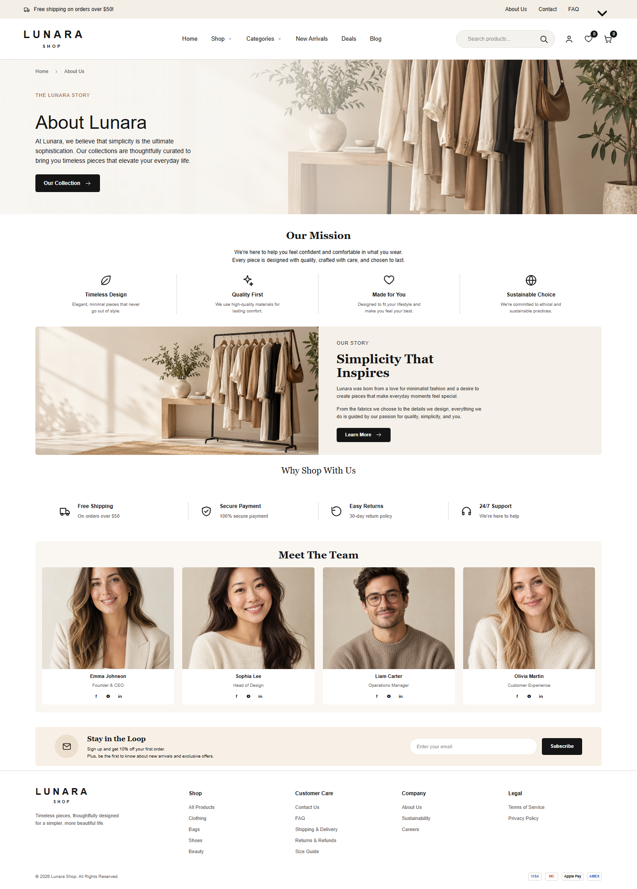</td>
      <td>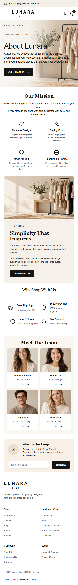</td>
    </tr>
  </tbody>
</table>

Cart, checkout, and admin routes are implemented and covered by source/tests, but no verified screenshots for those screens are currently stored in the repository. They are intentionally documented without fabricated imagery.

## Capabilities

### Storefront experience

- Homepage with local editorial imagery, category entry points, new arrivals, promotional banners, benefits, and newsletter/social sections.
- Published product catalogue with category routes, validated keyword/price/variant/stock/sale filters, new-arrival routes, sorting, and pagination. Filtered catalog remains preview-scoped and backed by the local database.
- Product detail pages with primary imagery, related products, variants, availability, pricing, and add-to-cart actions.
- Blog index and post routes backed by database models.
- About, contact, FAQ, shipping, returns, size guide, sustainability, privacy, and terms pages.

### Shopping and account experience

- Guest carts and authenticated carts stored through Eloquent models.
- Cart merge when a guest signs in, quantity validation, and stock-aware updates.
- Authenticated checkout with shipping details, coupon redemption, shipping calculation, transactional order creation, and inventory reservation.
- Registration, login/logout, password reset request/reset, profile updates, addresses, order history, and order detail views.
- Authenticated wishlist storage and toggle actions.
- Duplicate-safe newsletter subscriptions.

### Administration

The /admin area is protected by authentication and the admin middleware. The implemented modules include:

- Dashboard metrics.
- Products and product image records.
- Categories, brands, collections, and variants.
- Inventory and order status management.
- Customers and role updates.
- Coupons and reviews.
- Homepage banners and store settings.
- Blog categories, blog posts, and newsletter subscribers.
- Audit log records for selected administrative changes.

### Design and implementation baseline

- Responsive Blade layouts with a mobile navigation state powered by Alpine.js.
- Local storefront imagery under public/assets/lunara to avoid runtime dependence on remote demo images.
- Reusable Blade components for product cards, icons, benefits, pagination, and the shared application shell.
- Server-side request validation, role checks, CSRF-protected forms, database transactions, and row locking around stock-sensitive operations.
- Playwright coverage for responsive rendering, broken-image detection, horizontal overflow, product-to-cart flow, and protected admin access.

### Deliberate boundaries

The following points are not presented as complete features:

- Payment provider integration is implemented behind `PaymentService`: Stripe Checkout sessions are created when credentials exist, signed/idempotent webhook events reconcile payment and order state, and failed/expired payments release reserved stock. Local/testing without Stripe credentials stays an explicit simulation boundary; sandbox and production operations still require environment verification.
- The catalogue UI currently displays price, color, size, and availability controls, but the server-side catalogue query only wires category, keyword, sale/new-arrival, sort, and pagination parameters. Full faceted filtering remains planned.
- Email delivery, email verification, and production password-reset transport require deployment configuration.
- The project has not been declared production-ready or formally security-audited.

## Technology

| Layer | Technology | Role in Lunara |
| --- | --- | --- |
| Application | PHP 8.3+ | Runtime for the Laravel application |
| Backend | Laravel 13 | Routing, controllers, authentication, validation, sessions, Blade rendering, and application services |
| View layer | Blade | Server-rendered storefront, account, checkout, blog, and admin screens |
| Browser interaction | Alpine.js 3 | Mobile navigation and lightweight UI state |
| Styling | Tailwind CSS 4 and custom CSS | Vite-processed styling with Lunara's editorial visual system |
| Asset pipeline | Vite 8 with Laravel Vite Plugin | Development and production asset bundling |
| Persistence | MySQL with Eloquent ORM | Catalogue, accounts, carts, orders, inventory, content, and operations data |
| Testing | PHPUnit 12 and Playwright | Feature coverage and browser-level responsive checks |
| Payment boundary | Stripe-style signed webhook endpoint | Event intake scaffold at POST /api/payments/stripe/webhook |

## Architecture

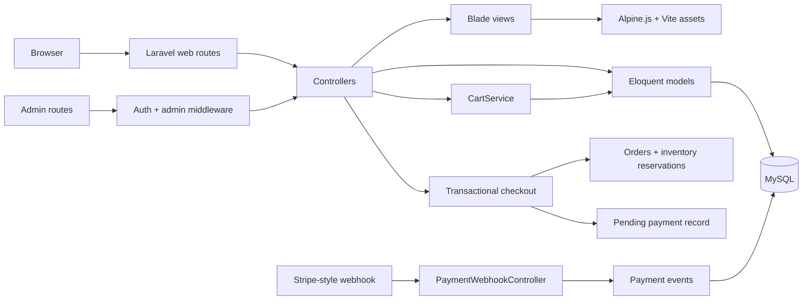

The storefront and admin interfaces share the Laravel application layer. Catalogue reads are Eloquent-backed; cart mutations and checkout use database transactions with stock checks. Authenticated account routes and /admin are separated by middleware, while the webhook is exposed through routes/api.php and validates its signature before recording an event.

## Project structure

    app/
    ├── Http/
    │   ├── Controllers/       Storefront, account, auth, commerce, blog, and admin actions
    │   ├── Middleware/        Admin authorization
    │   └── Requests/          Form request validation
    ├── Models/                Eloquent entities and relationships
    └── Services/              Cart and commerce services
    database/
    ├── migrations/            Catalogue, commerce, content, and admin-support schema
    ├── seeders/               Catalogue, visual asset, blog, coupon, and user seed data
    └── factories/             Test model factories
    resources/
    ├── css/                   Vite entry stylesheet
    ├── js/                    Alpine.js entrypoint
    └── views/                 Blade layouts, storefront, account, auth, blog, and admin UI
    public/
    └── assets/lunara/         Local product and editorial imagery
    routes/
    ├── web.php                Storefront, account, checkout, and admin routes
    └── api.php                Payment webhook route
    tests/
    ├── Feature/               Laravel feature and commerce tests
    └── e2e/                   Playwright browser checks and screenshot capture
    docs/
    ├── screenshots/           Verified desktop and mobile captures
    └── IMAGE_ASSET_MANIFEST.md  Local asset inventory and provenance notes

Root-level app.js, styles.css, index.html, and server.js are preserved legacy prototype files. They are not the active Laravel storefront entrypoint.

## Setup

### Requirements

- PHP 8.3 or newer with the extensions required by Laravel and PDO MySQL.
- Composer.
- Node.js and npm.
- MySQL 8 or a compatible MySQL server.
- Chromium for Playwright browser tests.

### Install

Clone the repository using its GitHub URL, then run the following from the project root:

    git clone <repository-url>
    cd <repository-directory>
    composer install
    npm install
    cp .env.example .env
    php artisan key:generate

On PowerShell, the environment copy step is:

    Copy-Item .env.example .env

Update the local database connection in .env for your MySQL installation. Do not commit .env or any deployment credentials.

Create the development and test databases before migrating:

    CREATE DATABASE lunara_shop CHARACTER SET utf8mb4 COLLATE utf8mb4_unicode_ci;
    CREATE DATABASE lunara_shop_test CHARACTER SET utf8mb4 COLLATE utf8mb4_unicode_ci;

Seed the development database and build the frontend:

    php artisan migrate --seed
    npm run build

The seeders populate the catalogue, local visual assets, blog content, coupons, and local user records for development. Review and replace seeded credentials before using the application outside a local environment.

### Run locally

Use the built assets with Laravel's development server:

    php artisan serve

Open http://127.0.0.1:8000.

For Vite hot reload during frontend work, run npm run dev in a second terminal.

### Test

The PHPUnit configuration targets the isolated lunara_shop_test MySQL database:

    php artisan test

The Playwright suite starts Laravel automatically according to playwright.config.js:

    npx playwright install chromium
    npm run test:e2e

Useful inspection command:

    php artisan route:list

## Quality and security

The source provides evidence for the following safeguards and quality checks:

- Laravel request validation for authentication, checkout, cart, account, newsletter, and admin mutations.
- Authentication for accounts, checkout, wishlist, and order access.
- Role-based authorization for the admin area through EnsureAdmin.
- Transactional checkout and lockForUpdate stock checks to reduce overselling races.
- Signed webhook verification and duplicate-safe event recording for the Stripe-style callback boundary.
- Feature tests for authentication, admin authorization, catalogue/commerce behavior, coupons, and inventory.
- Browser checks for responsive layouts, missing images, horizontal overflow, add-to-cart behavior, and protected admin navigation.

These controls do not replace a deployment security review. Rate limiting, upload scanning, CSP, payment operations, mail abuse controls, secret management, and production observability still require environment-specific hardening.

## Roadmap

- [x] Laravel storefront with Blade views and local visual assets.
- [x] Database-backed catalogue, categories, variants, inventory, and product detail pages.
- [x] Guest/authenticated cart handling and authenticated order creation.
- [x] Account area, wishlist, blog, newsletter, and protected admin modules.
- [x] Responsive Playwright coverage with stored desktop/mobile screenshots.
- [x] Implement provider-backed payment checkout, webhook state transitions, reservation release, and refund state handling; verify the provider sandbox before release.
- [ ] Wire faceted price, color, size, and availability filters to server-side query state.
- [ ] Configure transactional mail, email verification, and production password resets.
- [ ] Complete product-owner review for bulk actions, fulfillment tracking, delete workflows, and audit retention.
- [ ] Perform formal security, asset provenance, and production-readiness reviews.

## Assets and provenance

Primary storefront imagery is local to the repository under public/assets/lunara, with an inventory documented in [docs/IMAGE_ASSET_MANIFEST.md](docs/IMAGE_ASSET_MANIFEST.md). The repository records that commercial usage and provenance approval remain required before production use.

The README uses only repository-local screenshots and assets. No external product photography or fabricated live-demo capture is embedded.

 

**LUNARA — Modern Fashion, Thoughtfully Crafted.**

Built for a calmer, more considered way to shop.

  

<a href="#top">Back to top</a>

